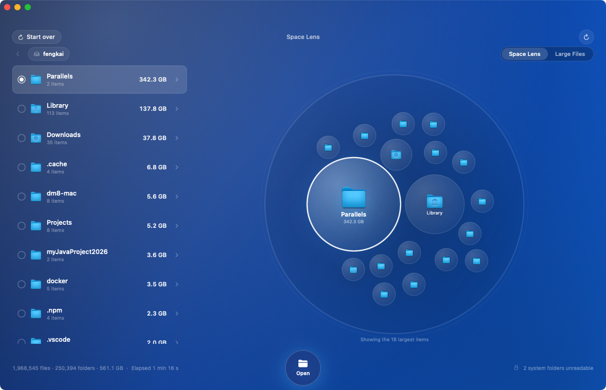
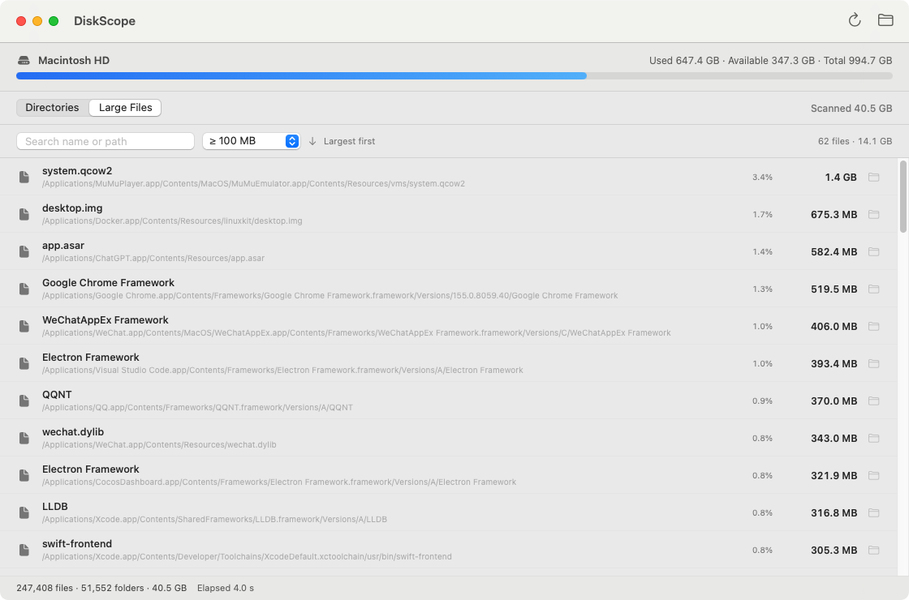
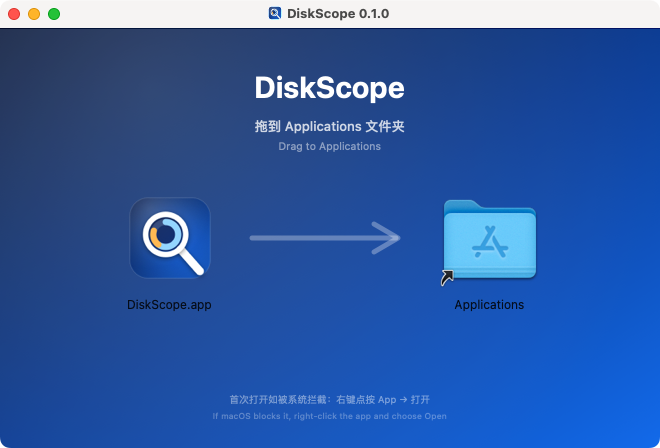

<p align="center">
  
</p>

# DiskScope

**See where every gigabyte goes.**

DiskScope is a fast, native macOS disk usage analyzer built with SwiftUI and
`getattrlistbulk(2)`. Scan a whole volume or a single folder, explore a circle-packed
Space Lens, and search a ranked list of the largest files.

[简体中文](README.zh-CN.md)






## Features

- **Whole disk or one folder** — scan the macOS data volume, or point DiskScope
  at a single directory.
- **Space Lens** — folders and files are packed into a circle by size, with a
  ranked list beside it. Select a circle or row to inspect it, then double-click
  or press Open to drill down. Breadcrumbs keep the path visible.
- **Large file finder** — filter by ≥10 MB / ≥100 MB / ≥500 MB / ≥1 GB, search by
  name or path, and reveal any file in Finder.
- **Honest accounting** — uses allocated size instead of logical size, dedupes
  hard links by `(dev, inode)`, and skips nested mount points.
- **Full Disk Access aware** — detects missing permission and tells you exactly
  which folders were skipped.
- **Local and read-only** — no network access, no telemetry, no deletion. The app
  never modifies your files.

## Requirements

- macOS 14.0 or later
- Apple Silicon or Intel Mac — the app ships as a universal binary
- Xcode 15.4+ to build from source

## Install

1. Download the latest `DiskScope-<version>.dmg` from
   [Releases](../../releases/latest).
2. Open the DMG. A guide window opens with the app on the left and the
   Applications folder on the right — drag **DiskScope** onto **Applications**.
3. Launch DiskScope and grant Full Disk Access when prompted.



> **Notarization:** release builds are signed for local development but are not
> notarized by Apple. If Gatekeeper blocks the first launch, right-click the app
> and choose **Open**, or run
> `xattr -dr com.apple.quarantine /Applications/DiskScope.app`.

### Full Disk Access

DiskScope is intentionally not sandboxed, because a sandboxed app cannot read
the whole volume. macOS protects Mail, Messages, Safari, Photos and other
folders with TCC. To measure them:

1. Open **System Settings → Privacy & Security → Full Disk Access**.
2. Add `/Applications/DiskScope.app` and enable it.
3. Rescan. Without this permission the app still works, but reports fewer bytes
   and scans more slowly.

## Build from source

From the repository root:

```bash
xcodebuild \
  -project DiskScope.xcodeproj \
  -scheme DiskScope \
  -configuration Release \
  -derivedDataPath build \
  build

open build/Build/Products/Release/DiskScope.app
```

Use the **Release** configuration. A Debug build runs the scanner roughly three
times slower; on the reference machine a full scan took 258 s in Debug and 94 s
in Release.

### Package a DMG

```bash
./scripts/package.sh
# -> dist/DiskScope-<version>.dmg
```

## Performance

Reference machine: Apple M1 Pro, 10 cores, 16 GB RAM, macOS 14.1.1.

| Scope | Files | Time |
|---|---:|---:|
| `/Applications` | 247k | 3.9 s |
| Home folder | 1.97M | 76 s |
| Data volume | 2.40M | 94 s |

The scanner runs eight concurrent `getattrlistbulk` workers. Results are kept as
a compact aggregate tree; a full 2.4M-file scan peaks at roughly 450 MB of
memory and releases it when the window closes.

## How it works

```
DiskScope/
├─ DiskScopeApp.swift     App entry point and menu commands
├─ Models.swift           DirNode / FileItem / ScanSummary
├─ Scanner.swift          getattrlistbulk workers + tree builder
├─ ScanStore.swift        Scan state, progress, navigation, permissions
├─ ContentView.swift      Welcome, scanning, directory browser
├─ BigFilesView.swift     Large-file search and ranking
├─ Components.swift       Capacity bar, status bar, formatting
├─ L10n.swift             Localization helpers
├─ en.lproj/…             English strings
├─ zh-Hans.lproj/…        Simplified Chinese strings
└─ zh-Hant.lproj/…        Traditional Chinese strings
```

- Directory entries are read in bulk with `getattrlistbulk(2)`, which returns
  name, type, device, inode, link count, logical size and allocated size in one
  syscall per batch.
- Child directories are pushed onto a shared work queue and consumed by eight
  workers.
- Files larger than 1 MB are kept individually (up to 400 per directory); smaller
  files are aggregated. The global large-file list keeps the top 50,000 entries.

## Localization

The UI follows the system language and ships with English, Simplified Chinese
and Traditional Chinese. To add a language, create a new `<lang>.lproj` folder
with a `Localizable.strings` file containing the keys used in `L10n.swift` and
the views, then add it to the `Localizable.strings` variant group in Xcode.

## Limitations

- **APFS clones** share physical blocks and cannot be identified from user
  space, so cloned files may be counted more than once.
- **Snapshots and purgeable space** are not part of the file tree. The scanned
  total can therefore be slightly lower than the volume's used space.
- **Protected system folders** such as `.fseventsd` and `.Spotlight-V100` remain
  unreadable even with Full Disk Access; the app reports their count.
- Very large directories show the top 500 child folders, and files below 1 MB
  are grouped into a single row.
- Scan results are in memory only; there is no incremental cache yet.

## Roadmap

- Treemap visualization
- APFS snapshot and purgeable-space reporting
- Duplicate file detection
- Incremental rescan with a persistent cache
- CSV export and a small CLI

## Contributing

Issues and pull requests are welcome. Please keep the scanner dependency-free and
the UI localized for every user-facing string. See [CONTRIBUTING.md](CONTRIBUTING.md).

## License

[MIT](LICENSE) © 2026 DiskScope contributors
