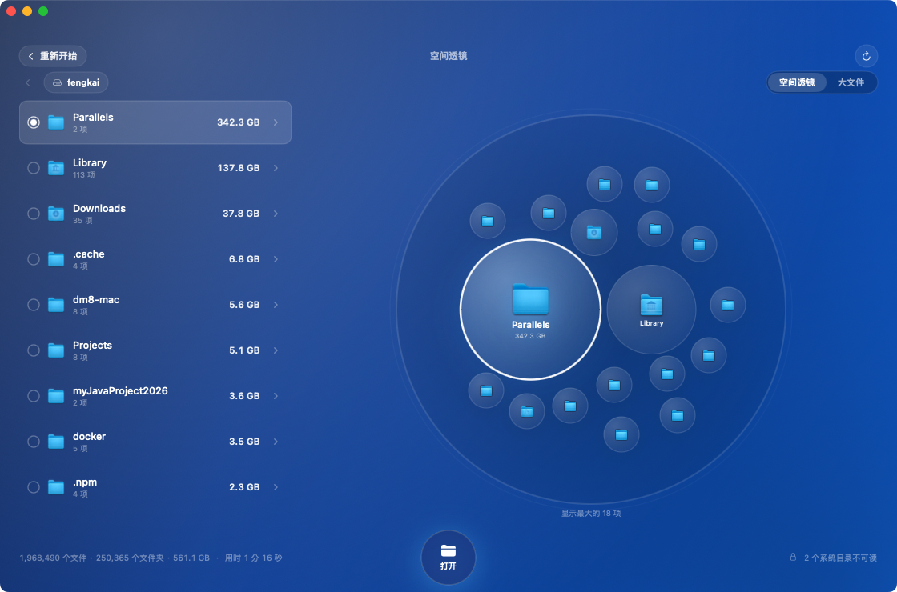
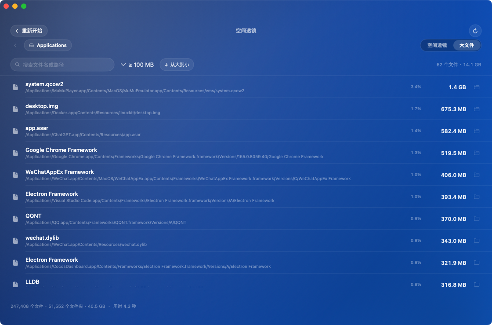

<p align="center">
  
</p>

# DiskScope（磁盘透视）

**看清每一个 GB 的去向。**

DiskScope 是一个用 SwiftUI + `getattrlistbulk(2)` 编写的原生 macOS 磁盘占用分析器。可以扫描整块数据卷，也可以只分析一个文件夹；结果以圆形「空间透镜」呈现，并提供可搜索的大文件榜。

[English](README.md)





## 功能

- **整盘 / 单目录扫描**：默认扫描 macOS 数据卷，也可以只分析指定文件夹。
- **空间透镜**：目录和文件按实际占用排布成圆形，左侧同步显示大小排行。点击圆圈或列表选中，双击或点「打开」进入下一层；面包屑始终显示当前路径。
- **大文件榜**：按 ≥10 MB / ≥100 MB / ≥500 MB / ≥1 GB 筛选，支持文件名与路径搜索，一键在 Finder 中定位。
- **统计准确**：按磁盘分配大小统计，硬链接按 `(dev, inode)` 去重，自动跳过嵌套挂载点。
- **权限提示**：检测“完全磁盘访问权限”，并明确显示有多少目录因权限被跳过。
- **本地、只读**：不联网、不上传、不删除、不修改文件。

## 环境要求

- macOS 14.0 或更高版本
- Apple Silicon / Intel Mac，App 为通用二进制
- 从源码构建需要 Xcode 15.4+

## 安装

1. 从 [Releases](../../releases/latest) 下载最新的 `DiskScope-<version>.dmg`。
2. 打开 DMG 会出现引导窗口：左侧是 App，右侧是 Applications 文件夹，把 **DiskScope** 拖到 **Applications** 上。
3. 启动 DiskScope，按提示授予完全磁盘访问权限。


> **关于公证：** 发布包使用本地开发证书签名，未经过 Apple 公证。如果首次启动被 Gatekeeper 拦截，请右键点击 App 选择“打开”，或执行
> `xattr -dr com.apple.quarantine /Applications/DiskScope.app`。

### 完全磁盘访问权限

DiskScope 刻意没有启用 App Sandbox，因为沙盒应用无法读取整块磁盘。macOS 通过 TCC 保护 Mail、信息、Safari、照片等目录。要统计这些内容：

1. 打开 **系统设置 → 隐私与安全性 → 完全磁盘访问权限**。
2. 添加 `/Applications/DiskScope.app` 并打开开关。
3. 重新扫描。没有授权时 App 仍可运行，但统计结果会偏小，扫描也更慢。

## 从源码构建

在仓库根目录执行：

```bash
xcodebuild \
  -project DiskScope.xcodeproj \
  -scheme DiskScope \
  -configuration Release \
  -derivedDataPath build \
  build

open build/Build/Products/Release/DiskScope.app
```

请使用 **Release** 配置。Debug 构建的扫描速度约慢 3 倍：参考机器上整盘扫描 Debug 为 258 秒，Release 为 94 秒。

### 打包 DMG

```bash
./scripts/package.sh
# -> dist/DiskScope-<version>.dmg
```

## 性能

参考机器：Apple M1 Pro，10 核，16 GB 内存，macOS 14.1.1。

| 范围 | 文件数 | 耗时 |
|---|---:|---:|
| `/Applications` | 24.7 万 | 3.9 秒 |
| 用户目录 | 197 万 | 76 秒 |
| 数据卷 | 240 万 | 94 秒 |

扫描器使用 8 个并发的 `getattrlistbulk` worker，只保留聚合结果；240 万文件的整盘扫描峰值内存约 450 MB，关闭窗口后释放。

## 实现

```
DiskScope/
├─ DiskScopeApp.swift     入口与菜单
├─ Models.swift           DirNode / FileItem / ScanSummary
├─ Scanner.swift          getattrlistbulk 并行扫描与建树
├─ ScanStore.swift        扫描状态、进度、导航、权限
├─ ContentView.swift      欢迎页、扫描页、目录浏览
├─ BigFilesView.swift     大文件搜索与排行
├─ Components.swift       容量条、状态栏、格式化
├─ L10n.swift             本地化辅助
├─ en.lproj/…             英文字符串
├─ zh-Hans.lproj/…        简体中文字符串
└─ zh-Hant.lproj/…        繁体中文字符串
```

- 通过 `getattrlistbulk(2)` 批量读取目录项，一次系统调用返回名称、类型、设备号、inode、链接数、逻辑大小和分配大小。
- 子目录进入共享任务队列，由 8 个 worker 并发消费。
- 大于 1 MB 的文件单独保留（每个目录最多 400 个），更小的文件聚合；全局大文件榜保留前 50,000 个。

## 多语言

界面跟随系统语言，内置 English、简体中文、繁體中文。新增语言时，新建 `<lang>.lproj/Localizable.strings`，补齐 `L10n.swift` 与视图中使用的 key，然后把该语言加入 Xcode 中 `Localizable.strings` 的 variant group。

## 已知限制

- **APFS 克隆**共享物理块，用户态无法识别，克隆文件可能被重复计算。
- **本地快照与可清除空间**不在文件树内，因此扫描总量可能略低于系统显示的已用空间。
- `.fseventsd`、`.Spotlight-V100` 等系统保护目录即使有完全磁盘访问权限也无法读取，界面会显示数量。
- 超大目录只展示前 500 个子文件夹；小于 1 MB 的文件合并为一行。
- 扫描结果只保存在内存中，暂不支持增量缓存。

## 路线图

- Treemap 可视化
- APFS 快照与可清除空间统计
- 重复文件检测
- 增量重扫与结果缓存
- CSV 导出与命令行工具

## 贡献

欢迎提交 Issue 和 Pull Request。请保持扫描引擎无第三方依赖，并为所有用户可见文案补齐本地化。详见 [CONTRIBUTING.md](CONTRIBUTING.md)。

## 许可证

[MIT](LICENSE) © 2026 DiskScope contributors
